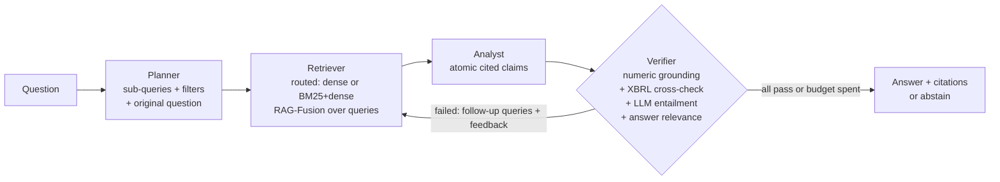

# SEC-RAG: a multi-agent RAG system for SEC filings with verified citations

This project answers questions about SEC 10-K and 10-Q filings. Each sentence in an answer cites the
part of the filing it came from. Every number is checked against the filing text and, optionally,
against the company's structured XBRL data. When a claim can't be verified, or the answer doesn't
address the question, the system searches again and rewrites the answer. If that still fails, it
abstains rather than guess.

**Headline results.** All numbers come from Qwen2.5-7B served locally with Ollama on a MacBook Air.

| | |
|---|---|
| Retrieval, Recall@5 (173 questions) | **89.6%** with query-type routing, vs 80.3% for plain BM25+dense RRF |
| Numeric QA, 83 held-out questions | **90.4%** accuracy and 91.5% precision when answering; 92.8% with the XBRL cross-check ([see caveat](#numeric-qa-held-out)) |
| Narrative QA, 30 questions | 96.8–97.8% claim faithfulness (LLM judge) |
| Biggest single improvement | Gold evidence reaching the Analyst went from 47.5% to 95% after error analysis showed the Planner's query rewriting was losing it |



| Agent | What it does |
|---|---|
| **Planner** | Splits the question into sub-queries with ticker, form and fiscal-year filters chosen from the ingested filings. It **always also searches with the user's own question** under the same filters. If the LLM call fails, a rule-based plan takes over. |
| **Retriever** | Sends numeric questions to **dense** retrieval and everything else to **BM25+dense RRF**. Results from all sub-queries are merged with **RAG-Fusion** (RRF across queries), so the chunks most likely to be relevant are listed first. If filtered search finds nothing, filters are relaxed one at a time. |
| **Analyst** | Writes the answer as atomic claims, each citing its evidence. Any derived number (growth rate, margin) must come with an explicit `calculation`. |
| **Verifier** | Checks every number in code against the cited text and the XBRL facts, allowing for units and rounding. Re-runs each `calculation` in a safe evaluator. Makes one batched LLM call that judges each claim against its sources **and checks whether the claims answer the question** (right line item, period, company). |

---

## Results

All evaluation code is in `src/secrag/evaluation.py`, and every number below can be reproduced with the CLI.

### Retrieval: Recall@5, filtered by company and fiscal year

| Retriever | Numeric (n=123) | Narrative (n=50) | All (n=173) | MRR@10 |
|---|---|---|---|---|
| BM25 | 61.0% | 94% | 70.5% | 0.525 |
| Dense (bge-small) | 87.8% | 90% | 88.4% | 0.627 |
| Hybrid (BM25+dense RRF) | 74.8% | 94% | 80.3% | 0.636 |
| **Routed** (numeric → dense, else hybrid) | **87.8%** | **94%** | **89.6%** | **0.647** |

**Finding:** no single retriever wins everywhere. BM25 *hurts* numeric table lookups, because it ranks MD&A paragraphs that repeat the metric's name above the table that actually holds the number. On narrative questions, especially exact-term ones, BM25 helps. A cross-encoder reranker (`bge-reranker-base`) lowered MRR from 0.550 to 0.505, because it isn't trained on number-heavy tables.

Numeric questions are auto-labelled from XBRL. The 50 narrative questions are 48 LLM-generated (with automatic checks, then a human spot-check) plus 2 written by hand. With about 24 questions per narrative type, one question moves the result by about 4 points.

### Numeric QA: development set (n=40, `--seed 1`, no verifier)

These 40 questions were used to find and fix failures, so they are **not** an unbiased measure.

| Change | Gold in context | Accuracy | Confident errors |
|---|---|---|---|
| Baseline | 47.5% | 52.5% | 37.5% |
| + also search with the original question | 95.0% | 72.5% | 5.0% |
| + RAG-Fusion ordering of the evidence | 95.0% | 75.0% | 2.5% |
| + fix Ollama's silent 4k-token prompt truncation | 95.0% | 97.5% | 2.5% |

**Error analysis (`scripts/diagnose_retrieval.py`):** for the 21 misses, the Planner's rewritten queries (e.g. `'net income'`) found the gold chunk **0 of 21** times, and the user's original question found it **18 of 21** times. The RAG-Fusion row was measured while prompts were still being truncated, so its +2.5 points is within noise.

### Numeric QA: held out (n=83, never looked at during development)

| Config | Accuracy | Coverage | Precision when answering | Confident errors | p50 latency |
|---|---|---|---|---|---|
| No verifier | 90.4% | 98.8% | 91.5% | 8.4% | 26.5s |
| Verifier, LLM checks only | 90.4% | 97.6% | 92.6% | 7.2% | 31.6s |
| Verifier + XBRL cross-check | 92.8% | 97.6% | 95.1% | 4.8% | 46.2s |

**Honest reading:** once retrieval was fixed, the LLM-based verification added **no measurable accuracy** on numeric questions. The extra 2.4 points come from the deterministic XBRL cross-check. That check is legitimate for real use, since XBRL data is public, but in this eval XBRL is also where the correct answers come from. So **90.4% is the independent number**, and the XBRL gain only shows that the cross-check is wired correctly.

### Narrative QA (n=30, LLM-generated questions)

| Config | Claim faithfulness (judge) | p50 latency |
|---|---|---|
| No verifier | 96.8% | 21.9s |
| Verifier, LLM checks only | 97.8% | 43.6s |
| Verifier + XBRL cross-check | 97.8% | 54.8s |

Once the Analyst gets a good context it is already faithful, so the verifier adds about 1 point for twice the latency. The judge is `llama3.1:8b`, a different model family from the generator. It sees only the claims and their citations, so this metric measures faithfulness, not completeness.

### Metric definitions

| Metric | Definition |
|---|---|
| Recall@5 | Share of questions where at least one gold chunk is in the top 5. A gold chunk is one from the right company that contains the gold number (XBRL questions) or the verbatim evidence quote (narrative questions). |
| Accuracy | The kept claims state the XBRL value, within the rounding the claim itself uses. Abstentions count as wrong. |
| Coverage / precision | Coverage is how often the system answers instead of abstaining. Precision is the share of those answers that are correct. |
| Confident errors | Share of questions answered **incorrectly**. For financial QA, abstaining is better than this. |
| Gold in context | Whether retrieval delivered the gold chunk to the Analyst at all. |

---

## Lessons learned

1. **Look at individual failures, not just averages.** Sorting failures into "retrieval miss" vs "wrong answer despite gold in context" showed that *every* failure was a retrieval miss. Without that split, the fix would have gone to the wrong component.
2. **Query rewriting can hurt dense retrieval.** The Planner shrank full questions into two-word queries. Adding the original question back is cheap and can only add candidates.
3. **Check the serving layer.** Ollama silently cut prompts longer than 4,096 tokens, removing the instructions and the question. To the eval this looked like the model failing (empty answers). Fix: `OLLAMA_CONTEXT_LENGTH=16384`.
4. **Make sure checks can't see the answer key.** Running with and without the XBRL cross-check showed where the verifier's gain actually came from.
5. **Hold out a test set.** Development-set accuracy was 97.5%; on unseen questions it was 90.4%.

## Design decisions

- **Routing instead of always hybrid:** the retrieval ablation showed dense wins numeric lookups and hybrid wins narrative questions. The router uses a fixed list of financial-statement terms, written in advance rather than fitted to the eval questions. It sent 100% of eval questions to the intended retriever, but the numeric questions come from one template, so treat that as an easy case.
- **RRF in two places:** across BM25 and dense rankings, and across sub-query rankings (RAG-Fusion). It uses ranks only, so scores on different scales never need normalising. k=60.
- **Atomic claims plus code-level number checks:** a 7B judge often approves a wrong digit, and the code check catches that every time. The LLM handles what code can't: wrong period, wrong subject, wrong line item.
- **Abstain instead of guessing:** unverifiable claims are dropped, and the answer says so.
- **Fiscal-year convention:** FY = the calendar year of the period end date (Apple FY2026 ends Sep 2026; NVIDIA FY2026 ends Jan 2026).

## Known limitations

- The numeric eval questions come from templates and are easier than real user questions.
- The XBRL cross-check uses the same source as the numeric eval labels (see above).
- The judge-based faithfulness score can be lenient; one observed case approved a claim that changed the subject of the source sentence.
- Section detection uses heuristics. One Tesla balance-sheet table is still never retrieved.
- Everything was evaluated with a single 7B generator served by Ollama. Results with vLLM or larger models may differ.

---

## Setup

```bash
python -m venv .venv && source .venv/bin/activate
pip install -e ".[dense,dev]"
cp .env.example .env        # set SEC_USER_AGENT="Your Name you@email.com"
pytest                       # 40 offline tests (scripted LLM, no GPU, no downloads)
```

**LLM server (any OpenAI-compatible endpoint):**

```bash
# Mac / laptop: Ollama. The default context is 4k, which silently truncates RAG prompts.
OLLAMA_CONTEXT_LENGTH=16384 ollama serve
ollama pull qwen2.5:7b && ollama pull llama3.1:8b
# .env: LLM_BASE_URL=http://localhost:11434/v1  LLM_MODEL=qwen2.5:7b  JUDGE_MODEL=llama3.1:8b

# NVIDIA GPU: vLLM
./scripts/serve_vllm.sh      # Qwen2.5-7B-Instruct, max-model-len 16384
```

### Running the eval on a GPU with vLLM (Kaggle, free 2× T4)

```bash
# on your machine: package code + index + eval sets (no raw filings, no .env)
zip -r secrag-kaggle.zip pyproject.toml src scripts eval/queries_xbrl.jsonl eval/queries_xbrl_holdout.jsonl data/index data/xbrl
```
Upload the zip as a private Kaggle Dataset, open `notebooks/kaggle_vllm_eval.ipynb` on Kaggle, add the dataset as an
input, set **Accelerator: GPU T4 ×2** and **Internet: On**, and run all cells. The notebook serves Qwen2.5-7B-Instruct
(fp16, tensor-parallel over both GPUs, 16k context), runs the held-out eval with 16 concurrent workers
(`eval-qa --workers 16`), and prints accuracy and throughput next to the Ollama results.

## Usage

```bash
# Ingest: 2 latest 10-Ks + 2 latest 10-Qs per company, plus XBRL facts
python -m secrag ingest --tickers AAPL MSFT NVDA AMZN GOOGL META JPM TSLA --limit 2

# Ask
python -m secrag ask "What was Apple's net income for fiscal 2026?" --trace
python -m secrag search "cybersecurity Item 1C" --tickers TSLA --year 2025 --mode bm25

# Build eval sets
python -m secrag make-queries --out eval/queries_xbrl.jsonl                     # auto-labelled numeric
python -m secrag make-text-queries --out eval/queries_synthetic.jsonl           # LLM-generated narrative, then spot-check

# Evaluate
python -m secrag eval-retrieval --queries eval/queries_xbrl.jsonl eval/queries_synthetic.jsonl --filters ticker_year
python -m secrag eval-qa --queries eval/queries_xbrl_holdout.jsonl --configs no_verifier verifier_no_xbrl verifier_xbrl
python -m secrag eval-qa --queries eval/queries_xbrl_holdout.jsonl --workers 16   # concurrent (vLLM)
python -m secrag qa-failures --verbose         # sort failures: abstained / retrieval miss / wrong answer
python scripts/diagnose_retrieval.py           # Planner sub-queries vs original question, for each miss
```

## Repo layout

```
src/secrag/
  edgar/      client.py (rate-limited, cached EDGAR API) · parser.py (sections + tables) · xbrl.py
  index/      chunker.py · embedder.py · store.py (BM25 + dense + RRF + rerank) · router.py
  agents/     planner.py · retriever.py · analyst.py · verifier.py · graph.py (LangGraph) · prompts.py
  numbers.py  numeric grounding + safe calculation checking
  evaluation.py · cli.py · app.py
scripts/      serve_vllm.sh · diagnose_retrieval.py · add_query.py
notebooks/    kaggle_vllm_eval.ipynb (final eval on vLLM)
tests/        offline tests incl. end-to-end self-correction runs with a scripted LLM
```
